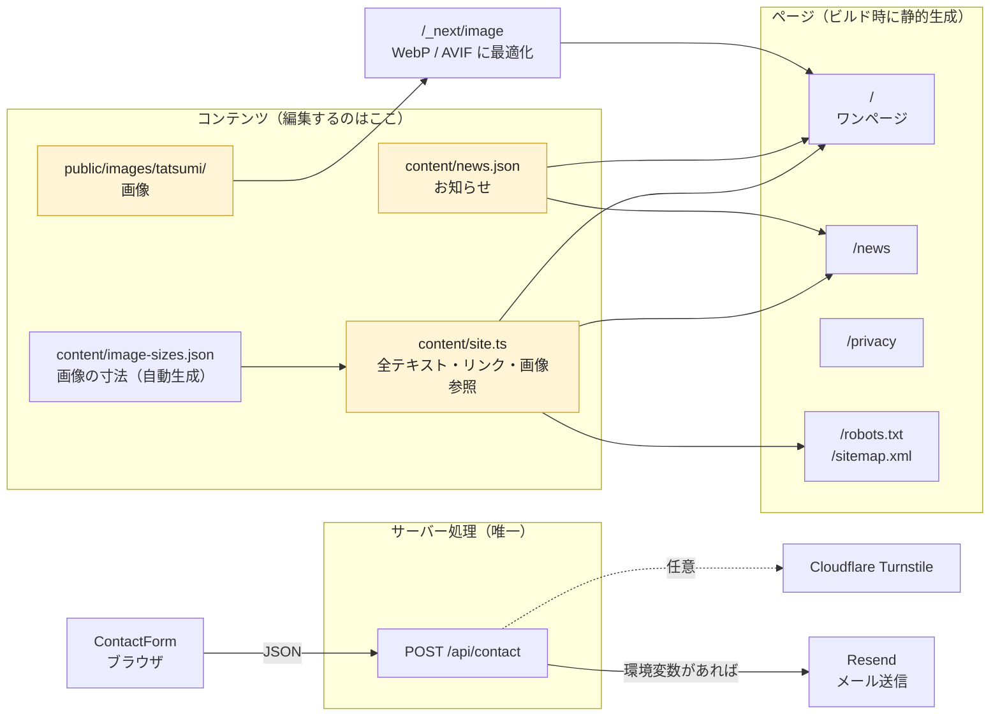
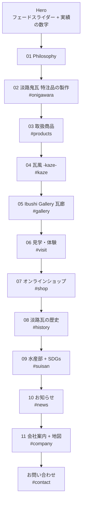
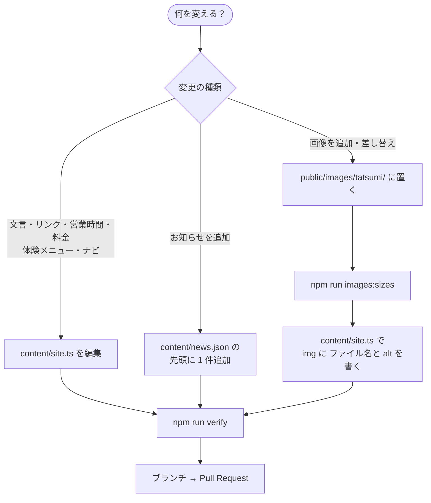
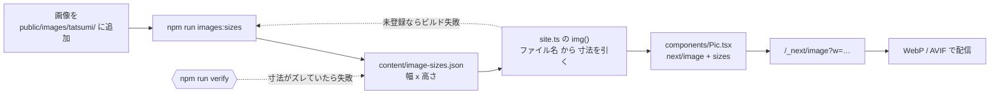
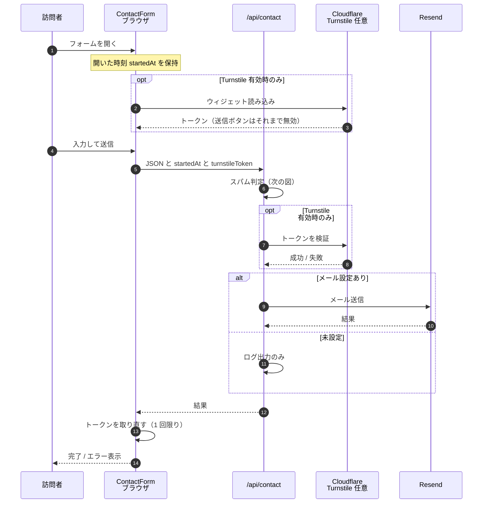
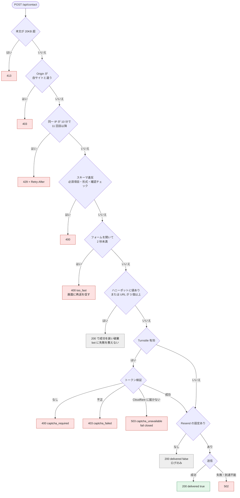
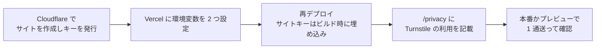
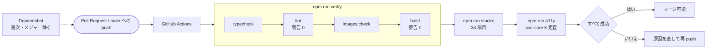
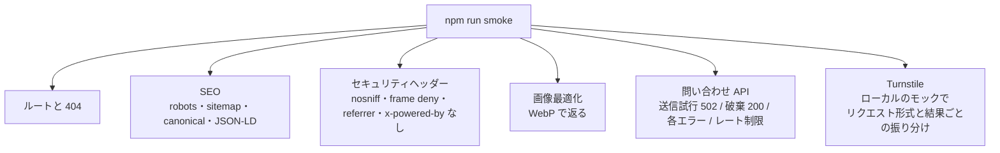
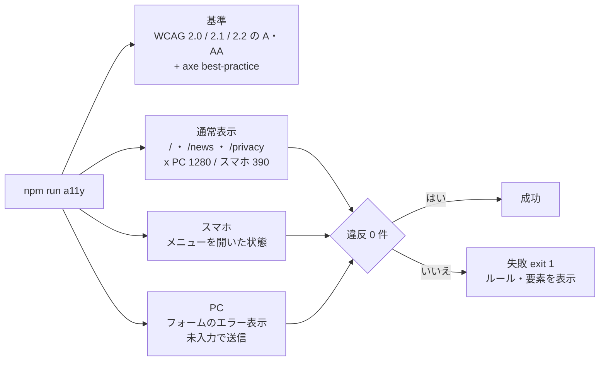

# 株式会社タツミ コーポレートサイト

兵庫県伝統的工芸品「淡路鬼瓦」指定窯元・株式会社タツミ（https://tatsumi-oni.co.jp）のサイトです。
Next.js 15（App Router）+ React 19 + TypeScript。Vercel にそのままデプロイできます。DB・認証はありません。

> 図は [Mermaid](https://mermaid.js.org/) で書いています（GitHub 上でそのまま表示されます）。

## 目次

[全体像](#全体像) ・ [ページ構成](#ページ構成) ・ [コンテンツの更新](#コンテンツの更新) ・ [画像の扱い](#画像の扱い) ・ [お問い合わせフォーム](#お問い合わせフォーム) ・ [開発](#開発) ・ [CI と品質ゲート](#ci-と品質ゲート) ・ [デプロイ](#デプロイvercel) ・ [環境変数](#環境変数) ・ [ディレクトリ](#ディレクトリ)

---

## 全体像

文言・お知らせ・画像は `content/` と `public/` に置き、ページはそれを読んで静的に生成します。サーバー処理は問い合わせ API の 1 本だけです。



| 区分 | 技術 |
|---|---|
| フレームワーク | Next.js 15（App Router）/ React 19 / TypeScript（strict） |
| スタイル | `app/globals.css` 1 枚（CSS Modules / Tailwind は不使用） |
| 画像 | `next/image`（`components/Pic.tsx` 経由） |
| フォーム | react-hook-form + zod（フォームとサーバーで同じスキーマ） |
| スライダー / 拡大表示 | embla-carousel（autoplay・fade）/ yet-another-react-lightbox |
| 品質 | ESLint 9・tsc・スモークテスト・GitHub Actions |

---

## ページ構成

トップは 1 ページに次のセクションが縦に並びます。ヘッダーのナビは `#onigawara #products #kaze #gallery #visit #company` へのアンカーです。



| # | セクション | ID | データ（`content/site.ts`） |
|---|---|---|---|
| – | Hero（スライダー） | – | `hero` |
| 01 | Philosophy | – | `about` |
| 02 | 淡路鬼瓦 特注品の製作 | `#onigawara` | `onigawara` |
| 03 | 取扱商品 | `#products` | `products` |
| 04 | 瓦風 -kaze- | `#kaze` | `kaze` |
| 05 | Ibushi Gallery 瓦廊 | `#gallery` | `gallery` |
| 06 | 見学・体験（工場見学／ワークショップ） | `#visit` | `visit` |
| 07 | オンラインショップ | `#shop` | `shop` |
| 08 | 淡路瓦の歴史 | `#history` | `history` |
| 09 | 水産部 ＋ SDGs | `#suisan` | `suisan`, `sdgs` |
| 10 | お知らせ | `#news` | `news`（`content/news.json`） |
| 11 | 会社案内（地図つき） | `#company` | `company` |
| – | お問い合わせ | `#contact` | `site`, `ContactForm` |

サブページ: `/news`（お知らせ一覧）、`/privacy`（プライバシーポリシー）。
SEO: `/robots.txt`・`/sitemap.xml`、全ページの canonical、トップの構造化データ（LocalBusiness）。

---

## コンテンツの更新

コードを書かずに `content/` と `public/` だけで更新できます。何を変えたいかで、触るファイルが決まります。



- **お知らせ**: `{ date, title, category("NEWS" | "BLOG"), note }`。トップには新しい順に 6 件、全件は `/news` に出ます。
- **画像**: 必ず意味のある日本語の `alt` を付けます。出典・権利が不明な画像は入れないでください。
- 住所・電話・FAX は `site` に集約されています（会社案内・お問い合わせ・フッターはそこを参照）。水産部の電話・FAX だけ `suisan.contact` です。

### 未確定の項目（`content/site.ts` の TODO）

| 項目 | 場所 | 状況 |
|---|---|---|
| 見学・体験の予約サイト URL | `site.reserveUrl` | 現在 `#`（クライアント確認待ち） |
| Instagram / LINE | `site.instagram` / `site.line` | 現在 `#`（クライアント確認待ち） |
| 設立年・代表者名・資本金・沿革 | `company` | 未記入 |
| favicon | `app/icon.*` | 未設定。正方形のシンボルマーク（SVG か 512px 以上）が必要 |
| 画像の解像度 | `public/images/tatsumi/` | 現行サイトの Web 用解像度。本番前に元データへ差し替え推奨 |
| 水産部の「成分と効用」 | – | 薬機法・景表法の観点で掲載を見送り（要クライアント確認） |
| プライバシーポリシー本文 | `/privacy` | 未掲載（Turnstile を有効にする前に必要） |

---

## 画像の扱い

すべての画像は `next/image` で表示し、配信時に WebP / AVIF へ変換されます（例: 384KB の JPG が 14〜23KB）。`next/image` に必要な寸法は `content/image-sizes.json` に自動生成して持ち、**画像を足したら生成し直す**運用です。



`` を直接書かず、`Pic` を使います（`sizes` は配置ごとに必須）。Hero の 1 枚目だけ `priority`、残りのスライドは先読みです。

---

## お問い合わせフォーム

`POST /api/contact` は、外部サービスを使わない多層のスパム対策を持ち、任意で Cloudflare Turnstile を足せます。環境変数がそろえば Resend でメールを送ります（未設定ならサーバーログに出すだけで、開発・プレビュー向けです）。

### 送信の流れ



### スパム判定の順序

上から順に判定します。安い判定を先に、外部通信を伴うものを最後に置いています。



**限界**: レート制限はサーバーのメモリ上で数えるため、Vercel ではインスタンスごとの集計です（厳密な上限は共有ストアが必要）。送信時間と `Origin` は、API を直接叩く標的型の bot には偽装できます。それを止めるのが Turnstile です。詳細は `docs/agents/architecture.md`。

### Cloudflare Turnstile（任意・既定は無効）

環境変数を **2 つとも**設定したときだけ有効になります（片方だけだと動きません）。未設定なら Cloudflare への通信は一切ありません。



> 本物の Cloudflare との疎通は自動テストでは確認できていません（開発環境から接続できないため）。有効にしたら、必ず実際に 1 通送って確認してください。公式のテストキーなら先に試せます。

---

## 開発

```bash
npm install
npm run dev        # http://localhost:3000（Turbopack）
```

| コマンド | 内容 |
|---|---|
| `npm run typecheck` | 型チェック（`tsc --noEmit`） |
| `npm run lint` | ESLint（警告 0 件を維持） |
| `npm run images:sizes` | 画像の寸法を `content/image-sizes.json` に書き出す |
| `npm run images:check` | 寸法 JSON が画像と一致しているか検証 |
| `npm run build` | 本番ビルド（Google Fonts を取得するため外部ネットワークが必要） |
| **`npm run verify`** | **typecheck + lint + 画像寸法チェック + build（変更後の標準チェック）** |
| `npm run smoke` | build 後に実行。ルート・SEO・ヘッダー・画像最適化・問い合わせ API の全判定を確認 |
| `npm run a11y` | build 後に実行。axe-core で全ページを走査（PC/スマホ・メニュー開・フォームのエラー表示）。違反 0 件が条件。Chromium が要る（`npx playwright install chromium`） |

---

## CI と品質ゲート

PR と `main` への push で GitHub Actions が `verify`・`smoke`・`a11y` を実行します。Dependabot が依存の更新を週次で提案します（メジャー更新は除く）。



スモークテストは、本番ビルドを実際に起動して確認します。



メールは実際には送られません。ダミーの Resend 設定で起動し、「送信を試みた = 502」「bot として破棄 = 200」の違いで振り分けを検証します。

アクセシビリティは `npm run a11y`（axe-core + Playwright）が、本番ビルドを実ブラウザで走査します。違反が 1 件でもあれば失敗し、CI で退行を防ぎます。



---

## デプロイ（Vercel）

1. GitHub に push → Vercel で Import（Framework: Next.js、設定変更不要）
2. 下の環境変数を登録して再デプロイ
3. `content/site.ts` の `site.url` が OGP・sitemap・canonical・構造化データの絶対 URL に使われます（本番ドメインであることを確認）

レスポンスには `X-Content-Type-Options` / `X-Frame-Options` / `Referrer-Policy` / `Permissions-Policy` を付けています（`next.config.ts`）。CSP は未設定です（Turnstile・地図の許可リストを確認できる段階で導入）。

## 環境変数

| 変数 | 必須 | 内容 |
|---|---|---|
| `RESEND_API_KEY` | メール送信に必要 | Resend の API キー（秘密） |
| `CONTACT_TO` | メール送信に必要 | 受信先アドレス |
| `CONTACT_FROM` | 任意 | 送信元。省略時は `株式会社タツミ <noreply@tatsumi-oni.co.jp>` |
| `NEXT_PUBLIC_TURNSTILE_SITE_KEY` | Turnstile 用 | 公開してよい値。**ビルド時に埋め込まれる**ので、設定後に再デプロイ |
| `TURNSTILE_SECRET_KEY` | Turnstile 用 | 秘密。**サイトキーと必ず両方**設定 |

`RESEND_API_KEY` と `CONTACT_TO` が未設定だと、問い合わせはメールで届かず、サーバーログに残るだけです。

---

## ディレクトリ

```text
.
├── app/
│   ├── page.tsx              ワンページ本体（content/site.ts を 01〜11 のセクションに描画）
│   ├── news/  privacy/       サブページ
│   ├── api/contact/route.ts  問い合わせ API
│   ├── robots.ts  sitemap.ts SEO
│   ├── layout.tsx            メタデータ・フォント・canonical
│   └── globals.css           スタイル（これ 1 枚）
├── components/               Header / Hero / Gallery / Pic / ContactForm / Turnstile / Footer / Reveal
├── content/
│   ├── site.ts               全テキスト・リンク・画像参照（唯一の情報源）
│   ├── news.json             お知らせ
│   └── image-sizes.json      画像の寸法（自動生成）
├── lib/                      contactSchema / spamGuard / turnstile / structuredData
├── public/images/tatsumi/    画像
├── scripts/                  smoke.sh / image-sizes.mjs
├── docs/agents/              エージェント向けの詳細ドキュメント
├── .claude/                  エージェント向けスキル（verify・add-news）と権限設定
└── .github/                  CI（ci.yml）と Dependabot
```

## エージェント向けドキュメント

AI エージェント（Claude Code など）で作業する場合の入口は **`CLAUDE.md`**（`AGENTS.md` から参照）です。詳細は `docs/agents/`:

| ファイル | 内容 |
|---|---|
| `architecture.md` | ルーティング・問い合わせ API の判定順と限界・SEO/セキュリティ設定・既知の事項 |
| `content-guide.md` | 文言・お知らせ・画像の更新手順と、推測で埋めてはいけない項目 |
| `workflow.md` | 自律作業の線引き（自分で決めてよいこと / 先に確認すること）と次の一手 |
